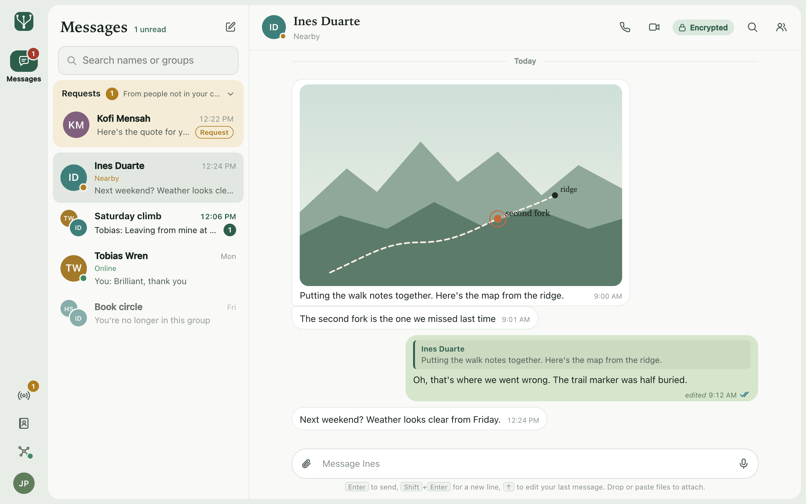
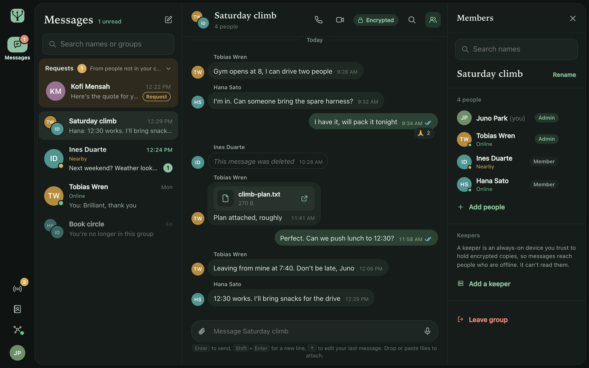
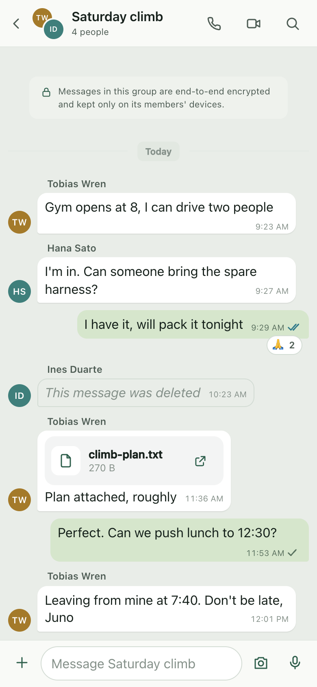
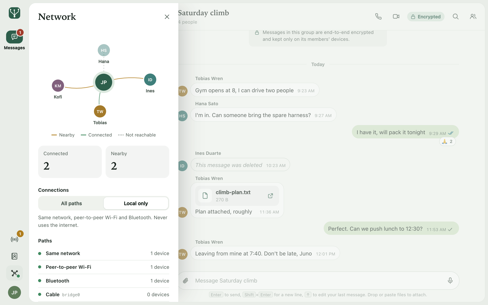
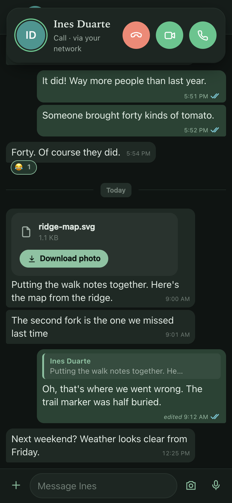

# Mycel

Mycel is a platform for private, peer-to-peer apps with no server. Every
device keeps its own keys, encrypts end to end, and checks everything it
receives; every device is also a router. Devices reach each other over the
same network, over the internet by key, over Bluetooth and peer-to-peer
Wi-Fi, and through other devices running Mycel, and messages for someone
who is offline are carried toward them by devices that can't read them. It
runs as one app on macOS, iPhone and iPad, Android, Windows and Linux, with
Messaging (chat, files, voice and video calls) built on it.

> **Experimental.** The cryptography and the trust layer have not had an
> external audit. Don't rely on Mycel to keep anything secret or safe yet.

<p align="center">
  
</p>

## What works today

- **Messaging:** direct chats and groups, message requests from strangers
  (nothing is sent back or stored until you accept), replies, edits,
  deletes, reactions, read receipts, typing, search, voice notes.
- **Files of any size**, encrypted as a stream, resumable, and downloaded
  from every member that has them at once.
- **Voice and video calls**, 1:1 and groups of up to 8, device to device,
  moving between paths mid-call.
- **End-to-end encryption with signed membership.** Each chat is a space
  with a signed membership graph, roles, and epoch keys sealed to each
  reader; removing a member rotates the key. Every change is signed and
  encrypted in its own envelope and checked before it is applied, so
  always-on **keepers** can store and serve a chat without being able to
  read it.
- **Rules in WebAssembly:** the chat rules, written in Rust and compiled to
  WASM, run deterministically on every peer.
- **Every path at once:** the same network (mDNS; Bonjour on iOS), the
  internet (hole punching, relays), Bluetooth LE, peer-to-peer Wi-Fi (Apple's
  AWDL), and other network interfaces such as a cable between two computers.
  Multipath QUIC adds up comparable paths and fails over between them.
  Bluetooth has run between a real iPhone and Macs; peer-to-peer Wi-Fi and
  Linux's Bluetooth and Wi-Fi Direct are built and tested on emulated links,
  not between real devices.
- **Every device a router:** a multi-hop mesh through nearby devices,
  gateways that let a Bluetooth-only device be reached from anywhere (signed
  records in the Mainline DHT), and store-and-forward through strangers.
- **No internet needed:** a *Local only* mode never contacts the internet.
- **Tested at scale in simulation** up to 10,003 devices, and against The
  ONE's routers on real contact traces: on Infocom 2006, 57 % of large
  messages delivered against the best router's 38 %, with 7 relays per
  delivery against 203 ([BENCHMARKS.md](docs/BENCHMARKS.md)).

What is built, layer by layer, and its limitations:
[docs/ARCHITECTURE.md](docs/ARCHITECTURE.md) §7.

## Screenshots

<p align="center">
  
  
</p>
<p align="center">
  
  
</p>

All screenshots are from the browser demo (`npm run dev`), with simulated people.

## Platforms

| Platform | What runs | How it was tested |
|---|---|---|
| macOS 11+ (Apple silicon and Intel) | everything, including Bluetooth and peer-to-peer Wi-Fi | the full test suite; the app on real Macs, over the LAN and Bluetooth to an iPhone. Peer-to-peer Wi-Fi on emulated links and on one Mac only |
| iPhone and iPad (iOS 16.4+) | everything, including Bluetooth and peer-to-peer Wi-Fi; calls continue in the background | the iOS Simulator; a real iPhone: LAN discovery through Bonjour, Bluetooth links to Macs. Peer-to-peer Wi-Fi and the camera haven't run on a device |
| Android 9+ | everything except Bluetooth and peer-to-peer Wi-Fi; keeps running in the background, also after a restart | the Android 14 emulator only |
| Windows 10+ | everything except Bluetooth, peer-to-peer Wi-Fi and the interface link; no echo cancellation | GitHub Actions runners only (build, core tests, launch, video without a camera); no run on real hardware |
| Linux (glibc 2.35+) | everything, with Bluetooth through BlueZ and Wi-Fi Direct groups (off by default); no echo cancellation | GitHub Actions runners only (build, core tests, launch, video without a camera); no run on real hardware, so BlueZ and Wi-Fi Direct are tested on emulated links only |

Details per feature: [docs/PLATFORMS.md](docs/PLATFORMS.md).

**Limitations to know:** Bluetooth runs on macOS, iOS and Linux, and
peer-to-peer Wi-Fi on macOS and iOS; Android and Windows have neither. A
suspended iPhone or iPad runs in "slow mode": it catches up when iOS lends
it time and over Bluetooth, so new messages may wait until Mycel is opened;
waking it on time would need Apple's push service, which needs a server,
which Mycel doesn't use. Each device is its own identity, and its key is the
account: there is no recovery if it is lost. Every device must run the same
build, because the wire format still changes.

## Try it

Test builds are on the [Releases](https://github.com/atullal/mycel/releases)
page; use the newest pre-release: a universal DMG for macOS, an APK for
Android, an installer and MSI for Windows, and a `.deb`, `.rpm` and AppImage
for Linux. Builds from CI come with a `SHA256SUMS` file and a build
provenance attestation (`gh attestation verify <file> --repo atullal/mycel`).
To run the current code, build from source.

- **The apps are unsigned.** On a Mac, right-click **Mycel > Open** the first
  time; if macOS says the app is damaged, run
  `xattr -dr com.apple.quarantine /Applications/Mycel.app`. Windows
  SmartScreen needs **More info > Run anyway**.
- **iPhone and iPad** need a build signed with your own Apple developer
  account (`scripts/package-ios.sh --install`).
- **Use the same build on every device you test with when you can.** Builds
  negotiate the protocol version ([docs/PROTOCOL.md](docs/PROTOCOL.md)),
  but older pre-release builds changed formats unannounced.

Installing, permissions, connecting devices, logs and troubleshooting:
[docs/USER_GUIDE.md](docs/USER_GUIDE.md).

## Build from source

Needs Rust (stable), Node.js 22.18 or later, and on a Mac the Xcode Command
Line Tools. On Linux, install the libraries the Linux job in
`.github/workflows/apps.yml` installs (WebKitGTK, D-Bus, ALSA, …). For the native
app also `cargo install tauri-cli --version '^2' --locked`.

```sh
npm install && npm run build                  # the UI
cargo build -p mycel-cli                      # the `mycel` CLI
./target/debug/mycel serve --name Alice       # a device with the web UI on http://127.0.0.1:7777
./target/debug/mycel keeper --data ~/.mycel-keeper   # an always-on keeper
./target/debug/mycel id                       # print this device's contact code
cargo test --workspace --exclude mycel-host   # about 500 Rust tests
npm test                                      # the TypeScript tests
```

`npm run dev` serves the UI in a browser with simulated people, no network.
The native apps (output in `dist-release/`; details in
[docs/PLATFORMS.md](docs/PLATFORMS.md)):

| Platform | Build | Output |
|---|---|---|
| macOS (Apple silicon + Intel) | `scripts/package-mac.sh --universal` | `Mycel_<v>_universal.dmg` |
| iPhone and iPad | `scripts/package-ios.sh` (`--install`, `--simulator`, `--unsigned`) | `Mycel_<v>_ios.ipa` |
| Android 9+ | `scripts/package-android.sh` (`--debug`) | `Mycel_<v>_android.apk` |
| Windows, Linux | `cargo tauri build` in `apps/host`, or the Apps workflow in GitHub Actions | installers, packages |

## Repository layout

```
crates/
  mycel-crypto      Ed25519, HPKE lockboxes, XChaCha20-Poly1305, streaming AEAD, BLAKE3
  mycel-trust       spaces: signed membership DAG, deterministic resolution, epochs
  mycel-sync        signed, encrypted envelopes → Automerge docs and causal feeds
  mycel-net         Iroh QUIC multipath, live sync, discovery, invites, blobs, the mesh
                    (mesh/core.rs routing, mesh/dtn.rs store-and-forward, gateways)
  mycel-link-awdl   link over Apple peer-to-peer Wi-Fi (AWDL, Network.framework)
  mycel-link-ble    link over Bluetooth LE L2CAP (CoreBluetooth; BlueZ on Linux)
  mycel-link-iface  link over any other network interface (a cable, a second NIC,
                    Wi-Fi Direct groups formed on Linux, …)
  mycel-call        voice calls, 1:1 and group: Opus over QUIC datagrams on every path
  mycel-video       video calls: hardware H.264 on Apple platforms, frames on QUIC streams
  mycel-rules       deterministic WASM rules engine (wasmi); mycel-rules-abi: the shared ABI
  mycel-kit-chat    the chat data model and deterministic reducer
  mycel-node        the runtime: storage, identity, contacts, messaging and calls API
  mycel-cli         `mycel serve | keeper | id | call`
  mycel-sim         simulator: real nodes over emulated radios, and up to 10,000+
                    virtual devices in virtual time
rules/              rule modules written in Rust, compiled to WASM (`rules/build.sh`)
packages/sdk        @mycel/sdk: TypeScript client, transports, React hooks
apps/messaging      the Messaging app (React, SDK only)
apps/host           the Tauri 2 host; src-tauri/gen/{apple,android} are the
                    iPhone/iPad Xcode and Android Gradle projects
bench/              benchmarks against The ONE on real contact traces
scripts/            packaging, CI helpers, the security check
vendor/             Iroh with a multipath patch, noq and noq-proto with a crash fix,
                    swarm-discovery, swift-rs and the Tauri notification plugin
                    with small fixes (see each MYCEL_PATCH.md)
docs/               the documents below
```

## Documentation

| | |
|---|---|
| [USER_GUIDE.md](docs/USER_GUIDE.md) | installing, connecting devices, logs, troubleshooting |
| [PLATFORMS.md](docs/PLATFORMS.md) | what works on which platform, how it was tested, building each app |
| [ARCHITECTURE.md](docs/ARCHITECTURE.md) | layers, design decisions, what is built, limitations, the mesh and global routing |
| [TRUST.md](docs/TRUST.md) | the trust layer: threat model, membership, keys, envelopes, resource limits, hardening, limitations |
| [ROUTING.md](docs/ROUTING.md) | routing: a survey of ~20 protocols, what Mycel reuses, and why |
| [PROTOCOL.md](docs/PROTOCOL.md) | every wire, signed and on-disk format, its version, and how versions and capabilities are negotiated |
| [RUNTIME_API.md](docs/RUNTIME_API.md) | the API apps use (Rust, Tauri commands, HTTP) |
| [RULES_ABI.md](docs/RULES_ABI.md) | the WASM rules ABI |
| [TESTING.md](docs/TESTING.md) | how to run the tests, what they cover, measured results |
| [SIMULATION.md](docs/SIMULATION.md) | the simulator: method, models, scenarios, findings |
| [BENCHMARKS.md](docs/BENCHMARKS.md) | store-and-forward against The ONE's routers on real contact traces |
| [CHANGELOG.md](CHANGELOG.md) | what this version contains |

## Contributing

See [CONTRIBUTING.md](CONTRIBUTING.md) and the
[Code of Conduct](CODE_OF_CONDUCT.md). In short: `main` stays green. A change
merges through a reviewed pull request with CI passing, after the workspace
tests pass twice in a row, with rustfmt and clippy (`-D warnings`) clean
([TESTING.md](docs/TESTING.md)).

## Security

Please report vulnerabilities privately, as described in
[SECURITY.md](SECURITY.md), not in public issues. What the trust layer
defends against, and what it doesn't: [docs/TRUST.md](docs/TRUST.md).

## Licence

Licensed under either of the [Apache License, Version 2.0](LICENSE-APACHE)
or the [MIT licence](LICENSE-MIT), at your option. Vendored and bundled
third-party components keep their own licences: see
[THIRD_PARTY_NOTICES.md](THIRD_PARTY_NOTICES.md).

Unless you explicitly state otherwise, any contribution you intentionally
submit for inclusion in Mycel, as defined in the Apache-2.0 licence, is dual
licensed as above, without any additional terms or conditions.
