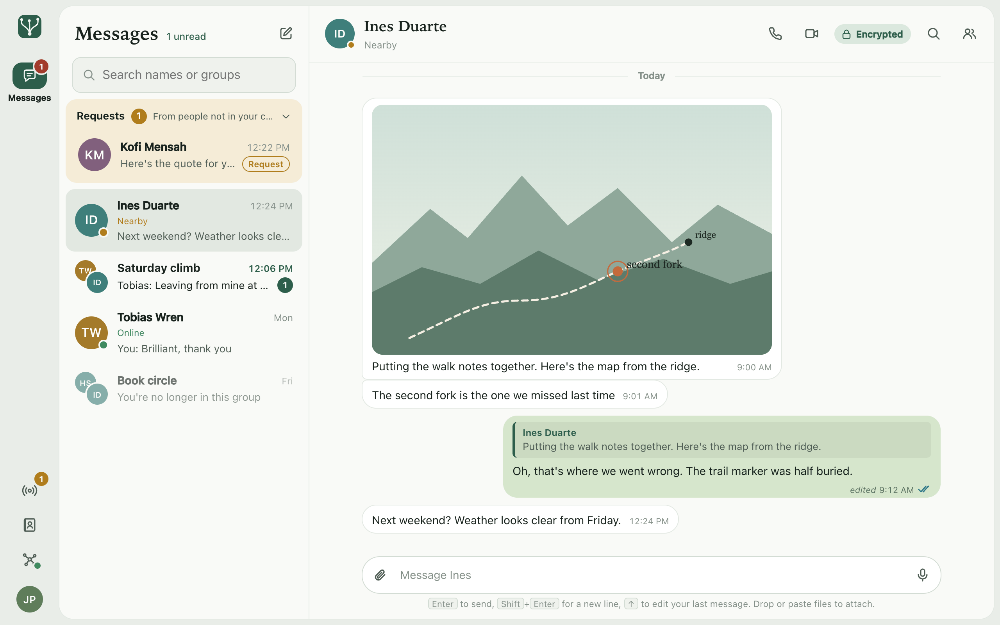

<p align="center">
  
</p>
<h1 align="center">Mycel</h1>
<p align="center">Private messaging with no server.</p>
<p align="center">
  <a href="https://github.com/atullal/mycel/actions/workflows/ci.yml"></a>
  <a href="#licence"></a>
</p>

Mycel is a messaging app, and the platform under it, in which devices talk to
each other directly. Every device keeps its own keys, encrypts end to end and
checks everything it receives. When two devices have no direct path, other
devices running Mycel carry the traffic between them without being able to
read it, and hold messages for someone who is offline.

It runs on macOS, Windows, Linux, Android, iPhone and iPad.

> [!WARNING]
> Mycel is experimental. Its cryptography and trust layer have not had an
> outside audit. Do not rely on it yet to keep anything secret or safe.

<p align="center">
  
</p>

## What it does

- Direct chats and groups, with replies, edits, reactions, read receipts,
  search and voice notes. A message from someone who is not a contact arrives
  as a request, and nothing is sent back until you accept it.
- Files of any size, sent in pieces that are checked as they arrive, resumed
  where they stopped, and fetched from every device that has them.
- Voice and video calls, one to one and in groups of up to eight, that move
  between network paths without dropping.
- End-to-end encryption with signed membership. Each chat has a signed record
  of who belongs to it; removing someone changes the key. Keys are sealed to
  each member with X25519 combined with ML-KEM-768, and are replaced on a
  schedule.
- Every path a device has, at once: the local network, the internet,
  Bluetooth, peer-to-peer Wi-Fi and a cable. A Local only mode never contacts
  the internet.
- A mesh. Devices forward each other's sealed traffic over several hops, a
  device the internet can reach relays for devices behind routers, and
  messages for someone offline wait with devices that agree to hold them.
- No server of its own. By default Mycel uses the public relay and lookup
  servers that [n0](https://n0.computer) runs for Iroh, which see only
  ciphertext. They can be switched off, and devices then find each other
  through the BitTorrent DHT.

Not every feature runs on every platform, and several have only been tested
in simulation or on one kind of device. [Platforms](docs/PLATFORMS.md) and
the [status](#status) section below say which.

## Install

The [website](https://atullal.xyz/mycel/) offers the build for your system.
Every build, for macOS, Windows, Linux and Android, is also on the
[releases page](https://github.com/atullal/mycel/releases), with a
`SHA256SUMS` file and a build provenance attestation:

```sh
gh attestation verify <downloaded file> --repo atullal/mycel
```

The [user guide](docs/USER_GUIDE.md) covers installing, the permissions the
app asks for, adding a contact and troubleshooting. Two things to know first:

- Everyone you talk to needs the same version. The format on the wire still
  changes between versions.
- iPhone and iPad need a build signed with your own Apple developer account
  ([how](docs/PLATFORMS.md)).

## Build from source

You need Rust (the toolchain in `rust-toolchain.toml` installs itself through
rustup), Node.js 22.18 or later, and on a Mac the Xcode Command Line Tools.
On Linux, install the libraries the Linux job in
[`apps.yml`](.github/workflows/apps.yml) installs.

```sh
npm install && npm run build                 # the user interface
cargo build -p mycel-cli                     # the mycel command
./target/debug/mycel serve --name Alice      # a device, with the UI on http://127.0.0.1:7777
```

`npm run dev` serves the interface in a browser with simulated people and no
network, which is the quickest way to look around. The native apps are built
with `scripts/package-mac.sh`, `scripts/package-ios.sh`,
`scripts/package-android.sh`, or `cargo tauri build` in `apps/host`;
[Platforms](docs/PLATFORMS.md) has the details.

To run the tests:

```sh
cargo test --workspace --exclude mycel-host
npm test
```

[Testing](docs/TESTING.md) lists every check CI runs and how to run it
locally.

## How it is put together

Mycel is a Rust core in a [Tauri](https://tauri.app) shell, with the
interface in React. The transport is [Iroh](https://iroh.computer): QUIC
connections dialled by public key, over several paths at once.

| Layer | Crates | What it does |
|---|---|---|
| Apps | `apps/messaging`, `apps/host` | the Messaging app and the host it runs in |
| SDK | `packages/sdk`, `mycel-kit-chat` | the TypeScript client and the chat data model |
| Rules | `mycel-rules`, `rules/` | validation rules compiled to WebAssembly, run the same on every device |
| Data and sync | `mycel-sync` | signed, encrypted changes; documents and ordered feeds |
| Trust | `mycel-trust`, `mycel-crypto` | signed membership, keys and their rotation |
| Network | `mycel-net`, `mycel-link-*` | connections, discovery, the mesh, store-and-forward |
| Calls | `mycel-call`, `mycel-video` | voice and video over the same connections |
| Runtime | `mycel-node`, `mycel-cli` | storage, identity, the API that apps use |

`mycel-sim` runs real nodes over emulated radios and up to ten thousand
virtual devices in virtual time; `bench/` compares store-and-forward delivery
with the routers of The ONE simulator on real contact traces.
[Architecture](docs/ARCHITECTURE.md) explains each layer and the reasons
behind the design.

## Documentation

The [documentation index](docs/README.md) lists everything. The places to
start:

| | |
|---|---|
| [User guide](docs/USER_GUIDE.md) | installing and using the app |
| [Architecture](docs/ARCHITECTURE.md) | how Mycel is built and why |
| [Security specification](docs/TRUST.md) | what is defended, how, and what is not |
| [Runtime API](docs/RUNTIME_API.md) | the API an app uses |
| [Configuration](docs/CONFIGURATION.md) | every setting |

## Status

Mycel works and is tested in CI on Linux, macOS and Windows, but it is not
ready to be relied on.

- No outside audit of the cryptography or the trust layer.
- Versions do not interoperate yet, and there is no migration between them.
- A device's key is the account. If the device is lost, there is no recovery.
- macOS and iPhone have run on real devices. Windows and Linux have only run
  in CI, and Android only in an emulator.
- Relaying between devices over the internet and lookups through the DHT have
  been tested between processes on one computer, not across real routers.
- A suspended iPhone or iPad receives nothing until Mycel is opened again:
  waking it would need a push server, and Mycel has none.

The [changelog](CHANGELOG.md) records what each version contains and its
known limitations.

## Contributing

Contributions are welcome. [CONTRIBUTING.md](CONTRIBUTING.md) explains how to
set up, which checks to run and how changes land; the
[Code of Conduct](CODE_OF_CONDUCT.md) applies to everyone taking part.

## Security

Report vulnerabilities privately, as [SECURITY.md](SECURITY.md) describes,
and not in public issues.

## Licence

Licensed under either the [Apache License, Version 2.0](LICENSE-APACHE) or
the [MIT licence](LICENSE-MIT), at your option. Vendored and bundled
third-party components keep their own licences, listed in
[THIRD_PARTY_NOTICES.md](THIRD_PARTY_NOTICES.md).

Unless you explicitly state otherwise, any contribution you intentionally
submit for inclusion in Mycel, as defined in the Apache-2.0 licence, is dual
licensed as above, without any additional terms or conditions.
